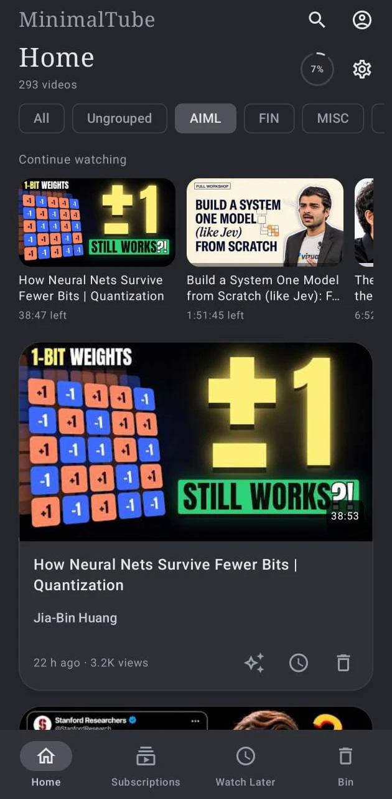
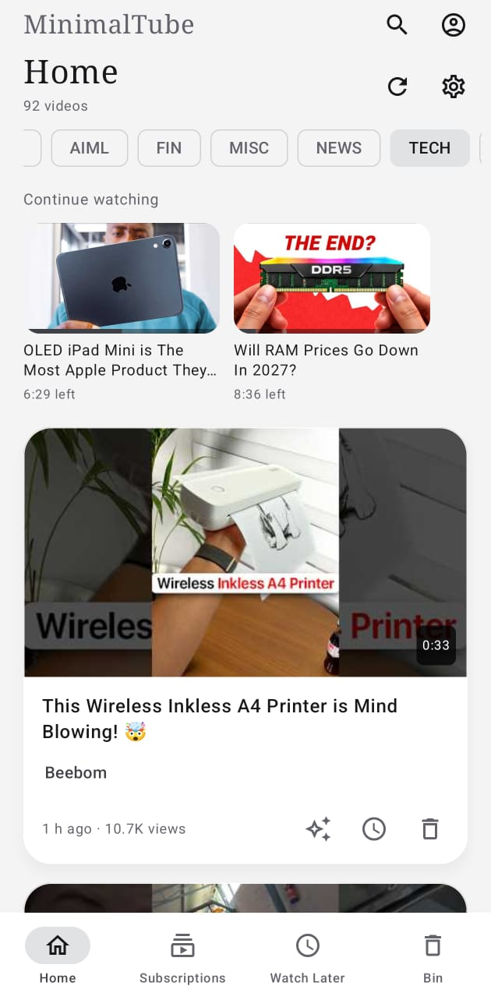

# MinimalTube

**YouTube without the algorithm: an Android app that shows only the videos from channels you choose.**

- **No recommendations.** Home is a newest-first list from your channels. Nothing is suggested, ranked or autoplayed.
- **Channels sorted your way.** Put channels in groups such as AI, Tech or Finance, and filter your feed by group.
- **Plays by YouTube's rules.** Videos run in YouTube's own embedded player through its official APIs, so ads still appear and nothing is downloaded.
- **Yours alone.** No account is needed. Subscriptions, groups and watch history stay on your phone.

<p>
  
  
</p>

## Get it

1. On your Android phone (Android 8 or newer), download **[MinimalTube.apk](https://github.com/amitprna/MinimalTube/releases/latest/download/MinimalTube.apk)** and open it. Android asks once to allow installing from your browser.
2. Create a free YouTube API key with the [key guide](docs/KEYS.md) and paste it into **Settings → API keys** in the app.
3. Open **Subscriptions → Add a channel** and type a channel's `@handle`.

<details>
<summary>Everything it does</summary>

- **Feed:** new videos from your channels, checked hourly or once a day at a time you pick, with a refresh button for now.
- **Groups:** one tap filters Home, Subscriptions, Watch Later and Bin; long-press a group to reorder.
- **Per-channel filter:** hide short videos, or set a minimum length.
- **Watch Later and Bin:** save any video for later from its card or from the player. The Bin empties itself after 24 hours, and binned videos never return to Home. Undo is one tap.
- **Resume:** after two minutes of watching, a video continues where you stopped, and a Continue watching row appears on Home.
- **Player:** full screen, playback speed with a saved default, back and forward 10 seconds, and a position bar.
- **Search** YouTube from inside the app.
- **Open YouTube links** from other apps, or share a link to MinimalTube.
- **Video summaries (optional):** add your own Gemini API key to get the key points of a video, with timestamps you can tap. See [Summaries](docs/SUMMARIES.md).
- **Backup and restore** your library to a file.
- **Light and dark** looks, or follow the phone.

</details>

<details>
<summary>What it does not do</summary>

No ad blocking, downloads, background playback or free Premium. MinimalTube is independent of Google and YouTube. [YouTube's terms](https://www.youtube.com/t/terms) and [API policies](https://developers.google.com/youtube/terms/developer-policies) apply to your use of it.

</details>

<details>
<summary>API keys, privacy and limits</summary>

- You use your own keys, entered on the phone and encrypted there. No keys ship with the app. [Key setup](docs/KEYS.md)
- The app has no server and no analytics. Requests go from your phone to Google. [Privacy](docs/PRIVACY.md)
- Google's free YouTube allowance is 10,000 units a day plus 100 searches. Checking 100 channels every hour uses about 2,700 units a day. [Quota reference](https://developers.google.com/youtube/v3/determine_quota_cost)
- Importing your YouTube subscriptions with Google sign-in works only for accounts the app's Google project has approved. Adding channels by `@handle` works for everyone.
- Updates install over the existing app and keep your data; uninstalling deletes it.

</details>

<details>
<summary>Build it yourself</summary>

Paste this page's link into an AI coding agent such as Claude Code and ask it to build MinimalTube and install it on your phone; it follows [AGENTS.md](AGENTS.md). Or by hand, with [JDK 17](https://adoptium.net/) and [Android Studio](https://developer.android.com/studio) installed:

```sh
cd android
./gradlew :app:assembleDebug
```

On Windows use `gradlew.bat`. The app file appears at `android/app/build/outputs/apk/debug/app-debug.apk`. An app you build yourself cannot update the downloaded one, and Google sign-in in it needs [your own setup](docs/DEVELOPER_GOOGLE.md).

</details>

[Contributing](CONTRIBUTING.md) · [Security](SECURITY.md) · [MIT license](LICENSE) · [Third-party notices](THIRD_PARTY_NOTICES.md)
